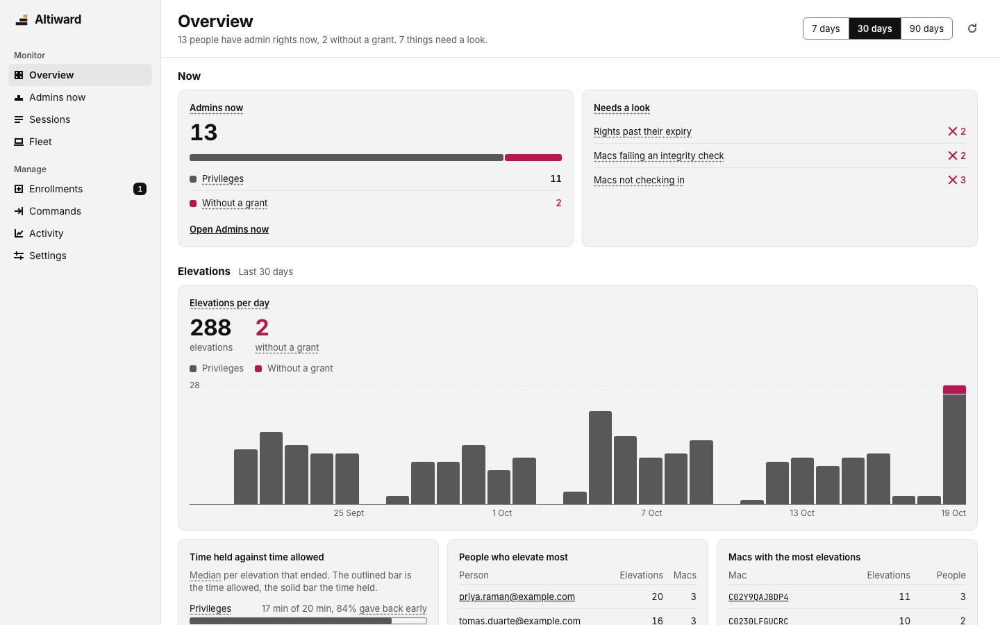

  

<h1 align="center">Altiward</h1>

Altiward is open-source oversight of Mac admin rights that works with SAP Privileges:
Privileges grants admin rights, and Altiward watches and enforces them. It shows who
holds admin on your Macs, for how long and why, checks every claim against the real
`admin` group, alerts when rights outlive their expiry (or removes them, if you choose),
revokes access from the console, and sends every event to your SIEM. It never grants
admin itself. You run the server yourself, and everything is Apache 2.0.

## Repositories

| Repository | What it is |
| --- | --- |
| [altiward](https://github.com/Altiward/altiward) | See and control who has admin rights on your Macs. Agent, server and console. Works with SAP Privileges. |
| [altiward-forwarder](https://github.com/Altiward/altiward-forwarder) | Forward SAP Privileges events to Splunk, Sentinel or syslog, from a relay or straight from the Mac. |
| [altiward-siem](https://github.com/Altiward/altiward-siem) | Detections, hunting queries and saved searches for Altiward and altiward-forwarder events in Sentinel and Splunk. |
| [altiward.com](https://github.com/Altiward/altiward.com) | The altiward.com website |

## Start here

- [Install guide](https://github.com/Altiward/altiward/blob/main/docs/install.md)
- [Security policy](https://github.com/Altiward/.github/blob/main/SECURITY.md): report a
  vulnerability privately
- [Discussions](https://github.com/Altiward/altiward/discussions): questions and ideas
- [Contributing](https://github.com/Altiward/.github/blob/main/CONTRIBUTING.md)

Altiward is an independent project, not affiliated with or endorsed by SAP.
